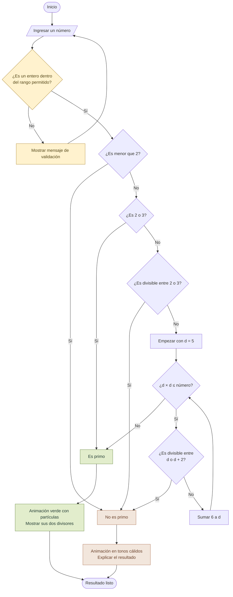

# Prisma · ¿Es primo?

Una aplicación en HTML, CSS y JavaScript para descubrir si un número es primo, con un diseño minimalista y animaciones que acompañan cada resultado.

> **Escribe un número → comprueba sus divisores → descubre el resultado.**

## 🚀 Cómo usarla

1. Descarga el archivo `prisma.html` de este proyecto.
2. Ábrelo con tu navegador. Funciona sin conexión y no requiere instalación.
3. Escribe un entero y pulsa **Descubrir si es primo** o la tecla **Enter**.

También puedes pulsar los ejemplos **7**, **29**, **42** y **97**.

## 🧭 Flujo de la aplicación

GitHub muestra este diagrama directamente en el README mediante Mermaid.



## 📝 Pseudocódigo

El algoritmo devuelve si el número es primo y, cuando corresponde, un divisor que explica por qué no lo es.

```text
AL ENVIAR EL FORMULARIO:
    Leer y quitar espacios al inicio y al final de la entrada

    SI la entrada no representa un entero
       O está fuera de −999999999999 a 999999999999:
        Mostrar un mensaje de validación
        Volver al campo de entrada
        TERMINAR

    número ← convertir la entrada a entero
    resultado ← ANALIZAR(número)

    SI resultado.esPrimo:
        Mostrar «¡Es un número primo!»
        Explicar que sus divisores son 1 y el propio número
        Activar la animación verde con partículas
    SINO:
        Mostrar «No es un número primo»
        SI número < 2:
            Explicar que los primos son enteros mayores que 1
        SINO:
            Mostrar divisor × (número / divisor) = número
        Activar la animación en tonos cálidos


FUNCIÓN ANALIZAR(número):
    SI número < 2:
        DEVOLVER (esPrimo: falso, divisor: ninguno)

    SI número = 2 O número = 3:
        DEVOLVER (esPrimo: verdadero)

    SI número MOD 2 = 0:
        DEVOLVER (esPrimo: falso, divisor: 2)

    SI número MOD 3 = 0:
        DEVOLVER (esPrimo: falso, divisor: 3)

    d ← 5

    MIENTRAS d × d ≤ número:
        SI número MOD d = 0:
            DEVOLVER (esPrimo: falso, divisor: d)

        SI número MOD (d + 2) = 0:
            DEVOLVER (esPrimo: falso, divisor: d + 2)

        d ← d + 6

    DEVOLVER (esPrimo: verdadero)
```

> **MOD** significa «residuo de una división». Si `número MOD divisor = 0`, la división es exacta.

## 💡 ¿Por qué funciona?

Un número primo es un entero **mayor que 1** que tiene exactamente dos divisores positivos: **1 y él mismo**.

- **Primero se descartan los casos sencillos:** los menores que 2 no son primos; 2 y 3 sí lo son.
- **Después se revisan 2 y 3:** cualquier otro múltiplo de estos números no es primo.
- **Finalmente se prueban candidatos por parejas:** `5 y 7`, `11 y 13`, `17 y 19`… Son los valores de la forma `6k − 1` y `6k + 1`. Todo primo mayor que 3 tiene una de estas formas, aunque pertenecer a ellas no garantiza ser primo.
- **Solo se busca hasta la raíz cuadrada:** si un número tiene factores, al menos uno de ellos es menor o igual que su raíz cuadrada. Por eso el ciclo usa `d × d ≤ número`.

La comprobación requiere **O(√n)** operaciones en el peor caso y **O(1)** memoria adicional.

## 🧪 Ejemplos

| Entrada | Resultado | Explicación |
| :--- | :--- | :--- |
| `2` | ✅ Primo | Sus divisores son 1 y 2. Es el único primo par. |
| `29` | ✅ Primo | Sus divisores son 1 y 29. |
| `42` | 🟠 No es primo | `2 × 21 = 42`. |
| `121` | 🟠 No es primo | `11 × 11 = 121`. |
| `1` | 🟠 No es primo | Solo tiene un divisor positivo. |
| `0` | 🟠 No es primo | Los primos son mayores que 1. |
| `-7` | 🟠 No es primo | Los números negativos no son primos. |
| `1.5` | ⚠️ Entrada inválida | La aplicación solicita un entero. |
| Campo vacío | ⚠️ Entrada inválida | Es necesario escribir un número. |

## 🎨 Respuesta visual

| Estado | Qué aparece |
| :--- | :--- |
| Antes de comprobar | Una esfera con órbitas y una invitación a explorar. |
| Número primo | Tonos verdes, una esfera que aparece con un rebote y partículas de celebración. |
| Número no primo | Tonos cálidos, una figura que se sacude y contornos que se separan. |
| Entrada inválida | Un mensaje junto al campo para corregir el valor. |

La aplicación adapta su diseño a pantallas pequeñas, anuncia los resultados a lectores de pantalla y respeta la preferencia de movimiento reducido del dispositivo.

## 🛠️ Tecnologías y alcance

- **HTML:** estructura del formulario y del resultado.
- **CSS:** diseño adaptable y animaciones.
- **JavaScript:** validación y comprobación de primalidad.
- **Sin dependencias externas, servidor ni conexión a Internet.**

Se aceptan enteros entre **−999.999.999.999 y 999.999.999.999**. Escríbelos **sin separadores de miles ni decimales**; por ejemplo, `1009`. El signo `+` o `-` es opcional.

## 📂 Archivos del repositorio

```text
.
├── README.md      # Guía, diagrama y pseudocódigo
└── prisma.html    # Aplicación completa: HTML, CSS y JavaScript
```

Para publicarla con GitHub Pages, puedes renombrar `prisma.html` a `index.html` y actualizar las referencias de este README al nuevo nombre.
